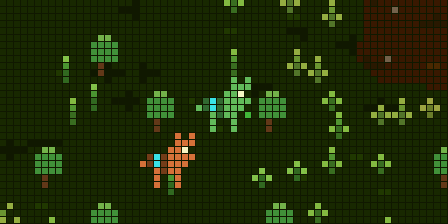
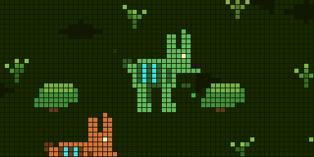
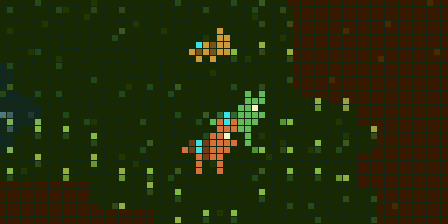
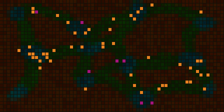
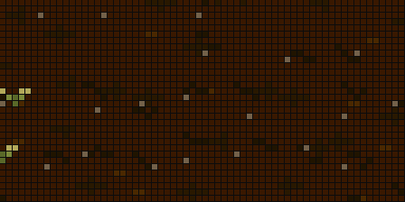
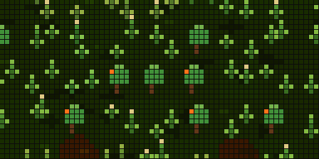
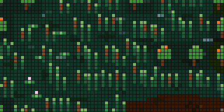
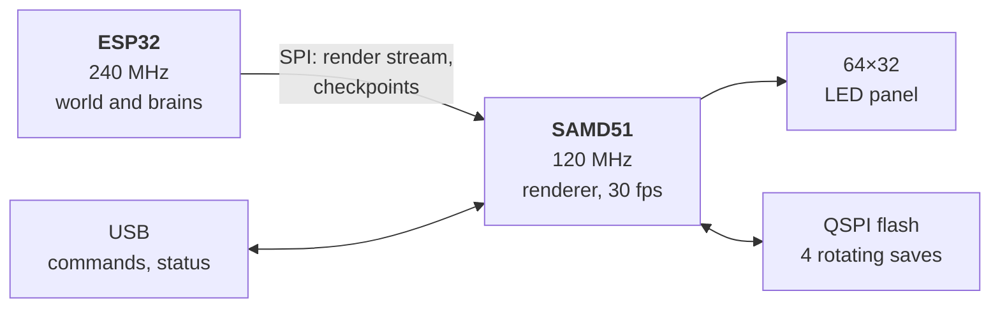

# Petri

**An evolving ecosystem on a 64×32 LED panel: how much emergent life fits on a
MatrixPortal M4?**

<p align="center">
  
</p>

Petri is an artificial-life world that runs entirely on an Adafruit
MatrixPortal M4. Plants grow from soil and rain, creatures graze, hunt, breed
and die, and every creature carries genes for its diet, its body and,
in the latest worlds, an evolved neural network that chooses what it does. The
board's ESP32 co-processor runs the biology and the SAMD51 draws it on the
panel at 30 frames per second. Nothing on the panel is staged: every sprite is
a creature in the simulation, drawn from its genes.

The project is an experiment in limits. Every byte and microsecond was
counted. The world, the brains and the save files were fitted into about
157 KB of usable ESP32 memory and 2 MB of flash, with the simulation kept
bit-for-bit identical between the board and a desktop build. It is now
complete. Its findings carry forward into **Petri HD**, a successor for a
Raspberry Pi with a touchscreen, in development.

## What's on the panel

<table>
  <tr>
    <td></td>
    <td></td>
  </tr>
  <tr>
    <td><b>Detail.</b> The closest zoom. Size, pigment, pattern and number of limbs all come from each creature's genes.</td>
    <td><b>Zoom 3.</b> A wider stretch, with creatures crossing between biomes.</td>
  </tr>
  <tr>
    <td colspan="2"></td>
  </tr>
  <tr>
    <td colspan="2"><b>The whole world, as a time-lapse</b> of about 19,000 ticks. Each LED covers 2×2 cells: creatures are orange, carcasses pink, and the ground is tinted by biome and plant cover as the rains move.</td>
  </tr>
</table>

| Scrub | Grassland | Wetland |
| :---: | :---: | :---: |
|  |  |  |

These images come from the real renderer through `petri_snapshot` (see
[Build and run](#build-and-run)), each LED drawn as a square. The panel also
draws:

- **Plants:** each biome has its own forms, which lean with storm winds and
  thin out where creatures graze.
- **Death:** fresh carcasses, and bones as they decay.
- **Weather and seasons:** rain from the world's moving storm fronts, and a
  season tint.

## The world

- **Terrain and climate:** 128×64 cells of scrub, grassland and wetland, set
  by soil moisture. Regional rainfall and up to four storm fronts move across
  the map, so habitats shift and succeed one another over thousands of ticks.
- **Plants and soil:** plants grow from soil nutrients and daylight. Dead
  matter decays back into the soil. Fruiting shrubs root and ripen fruit.
- **Creatures:** up to 320 at a time, each with its own lineage. Their genes
  cover:
  - plant and meat digestion and metabolic thrift;
  - a moisture preference;
  - hunting and evasion;
  - a faction marker;
  - nest care;
  - four body genes: size, pigment, pattern and limbs.

  Offspring inherit with mutation.
- **Reproduction:** by budding, or between two parents with nests, guarding
  and provisioning of the young.
- **Brains** (`--brains`, `--trophic`): each creature has a 247-byte integer
  neural network that decides each tick whether to stay or move, and whether
  to sprint, breed or signal. Moving into another creature is an attack. It
  reads its senses out to 6 cells: plants, creatures, kinship,
  habitat and its own state. All creatures decide from the same snapshot of
  the world before any acts, so the result doesn't depend on update order. A
  nursery breeds the founding brains, since random ones die out within 300
  ticks.

Everything is integer arithmetic with seeded random numbers. A world replays
exactly from its seed, and its fingerprint matches between the desktop, the
ESP32 and a save-and-restore in either place.

## The hardware

- **Board:** an [Adafruit MatrixPortal M4](https://learn.adafruit.com/adafruit-matrixportal-m4)
  driving a 64×32 HUB75 RGB matrix.
- **Diffuser:** a printed grid, [`hardware/diffuser`](hardware/diffuser), a
  parametric OpenSCAD model for common panel pitches. It turns each LED into
  a crisp square pixel.



| Measured on the board | |
| --- | --- |
| Display | 30 fps at up to 8 ticks/s |
| ESP32 speed | 200 ticks/s with fixed rules; about 110 ticks/s with brains |
| One brain decision | 56 µs: 33 to sense, 25 to run the network |
| World state | about 86 KB, plus 79 KB of brain weights split across eight blocks |
| ESP32 heap free while running | about 72 KB |
| Saves | every 10 minutes, up to 177 KB, restored at boot by streaming |
| Determinism | board fingerprints match native, before and after a save and restore |

**Controls:**
- **UP:** change the view (close, detail, hunt, whole world, habitat).
- **DOWN:** cycle 1, 2, 4 and 8 ticks/s; hold DOWN to pause.
- **Over USB:** `>` and `|` do the same, and `S` saves now.

## What we found

Every change was tested on eight matched seeds against controls, at 50,000
ticks. The [experiments](docs/experiments/README.md) and
[EMERGENT_LIFE.md](docs/EMERGENT_LIFE.md) have the commands and full
tables.

| World | Kills per run | Living mainly on meat | Founding lineages left | Beats the shuffled-brain control |
| --- | ---: | ---: | ---: | --- |
| Fixed behavior rules | 1–8 | 0 | 1 of 32 | — |
| Evolved brains | 23–1,808 | 0 | 1 | No |
| Brains with trophic economics | 13,262–19,361 | 0 | 1 | Partly: more births on 7 of 8 seeds, more kills on all 8 |
| Social: brains with two parents, nests and kinship | 3,258–4,491 | 0–1 | median 1.5 | No |

What these results show:

- **Fights appeared, but not predators.** With brains and trophic economics
  a third of all deaths became kills. But creatures attacked to clear
  competitors off the plants, not to eat, and the meat gene fell.
- **There is too little meat in a 320-creature world.** All the flesh moving
  through it would feed about six full-time meat-eaters. A predator level of
  30 needs about five times the grazers, which needs more creature slots than
  the ESP32's memory holds.
- **Kinship changed behavior.** Once brains could sense kin, kills of young
  by their parents fell from a third of all kills to a median of 5%. In the
  social world four fifths of young fledge, and for the first time more than
  one founding lineage survives.
- **Inheritance is hard to prove.** A control world gives each newborn the
  brain of a random living creature instead of its parent's. It usually does
  as well, so most of what the brains do comes from the bred founders, not
  from evolution during the run.

The limits Petri reached are partly design and partly hardware. There is
room for neither more creatures nor larger brains, and that is where Petri HD
picks up.

## Build and run

The simulation builds anywhere with CMake 3.16+ and a C++17 compiler, with no
dependencies. The 128×64 world is the one the board runs; the default build
is the original 64×32.

```sh
cmake -S . -B build-wide -DCMAKE_BUILD_TYPE=Release -DPETRI_WIDE_WORLD=ON
cmake --build build-wide
ctest --test-dir build-wide --output-on-failure
```

Run a world headless. It prints the census and a fingerprint:

```sh
./build-wide/petri --seed 14 --ticks 50000 --predation --food-web --morphology
```

The social brains world, with the observatory's environment:

```sh
./build-wide/petri --seed 14 --ticks 50000 --predation --food-web --connected-biomes \
  --irregular-terrain --staggered-growth --fruiting-plants --dynamic-environment --storms \
  --morphology --faction-markers --trophic --sexual --nests --guarding --provisioning
```

Render the panel without the board, as a PNG with one row per view and one
column per frame:

```sh
./build-wide/petri_snapshot sheet.png --seed 42 --ticks 20000 --frames 4
```

`petri --help` lists every option. `--save` and `--load` write and resume
checkpoints, and `petri_nursery` breeds new founder brains.

### Build the firmware

You need:
- `arduino-cli` with the Adafruit SAMD core and the Protomatter library;
- ESP-IDF v5.5.6 and esptool;
- [`uf2conv.py`](https://github.com/microsoft/uf2/tree/master/utils).

On Linux, the board needs a udev rule; see the lab notebook's
[ESP32 bridge](docs/LAB_NOTEBOOK.md#esp32-bridge) section. Build the ESP32
world app and the SAMD51 display, then flash both:

```sh
(cd esp32 && . ~/esp/esp-idf-v5.5.6/export.sh && idf.py -B build-world -DSDKCONFIG=build-world/sdkconfig build)
firmware/build_petri_uf2.sh ~/.local/share/uf2/uf2conv.py build/petri-display.uf2 --display
tools/board/flash_esp32.sh build-world build/petri-display.uf2
```

[`tools/board/`](tools/board/README.md) covers the rest:
- starting a fresh world;
- driving the display over USB;
- soak tests;
- the ESP32 self-test against native fingerprints.

## Repository

| Path | Contents |
| --- | --- |
| `core/` | The simulation: world, food web, nests, hunting, brains, checkpoints |
| `render/` | The panel renderer, render state and the stream between the chips |
| `link/` | The SPI link protocol |
| `esp32/` | ESP-IDF apps: the world app and the self-test |
| `firmware/` | SAMD51 sketches: the display, the bridge, and test firmware |
| `apps/` | `petri`, `petri_snapshot`, `petri_nursery`, `petri_observer` |
| `tests/` | Native tests, including compatibility with older checkpoints |
| `tools/` | Board scripts and generators |
| `hardware/diffuser/` | The printable LED diffuser |

## Documents

- [SPEC_AND_ROADMAP.md](docs/SPEC_AND_ROADMAP.md): the original design and
  roadmap.
- [DUAL_PROCESSOR.md](docs/DUAL_PROCESSOR.md): how the ESP32 and SAMD51 share
  the work.
- [GRAPHICS_AND_EVOLUTION.md](docs/GRAPHICS_AND_EVOLUTION.md): the panel
  graphics and the body genes.
- [EMERGENT_LIFE.md](docs/EMERGENT_LIFE.md): brains, trophic economics,
  kinship, and the results on the board.
- [experiments/](docs/experiments/README.md): matched-seed experiments, with
  commands to replay them.
- [LAB_NOTEBOOK.md](docs/LAB_NOTEBOOK.md): the complete development record:
  checkpoint versions, memory layouts, and every firmware step.
